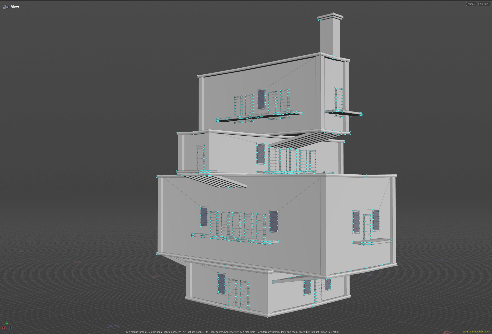
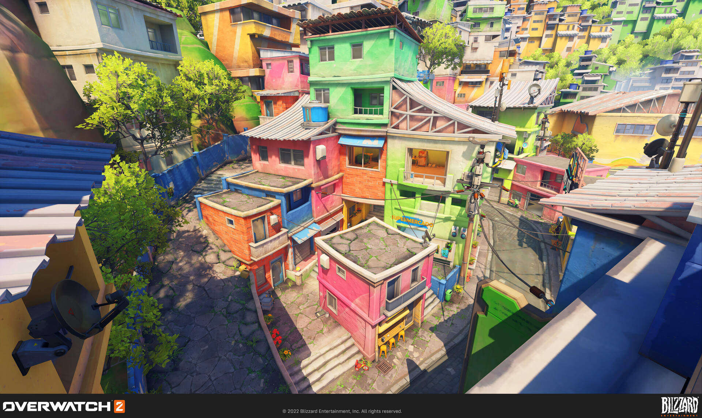
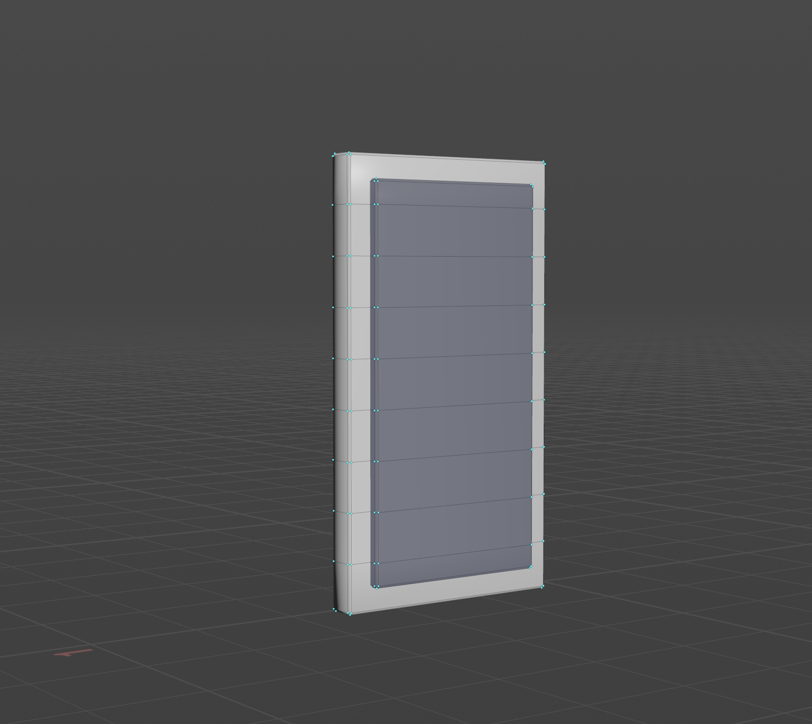
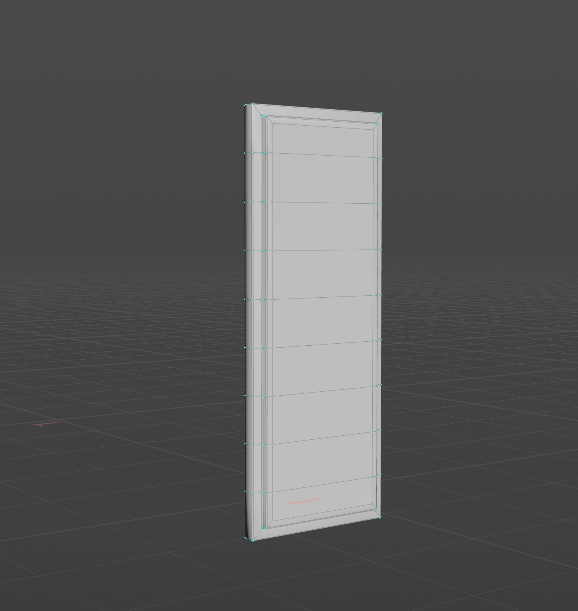
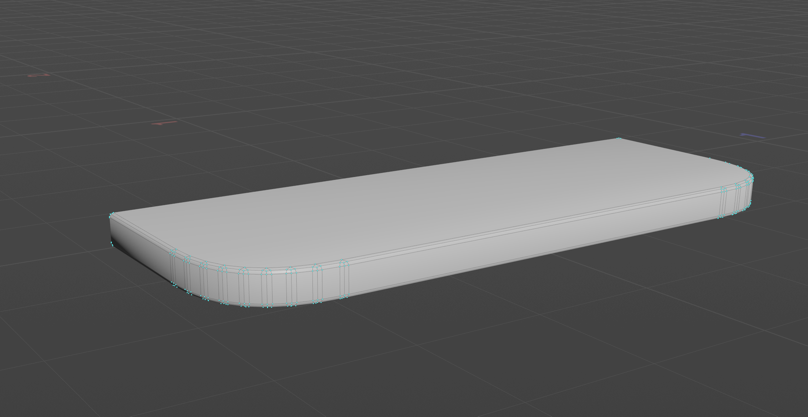
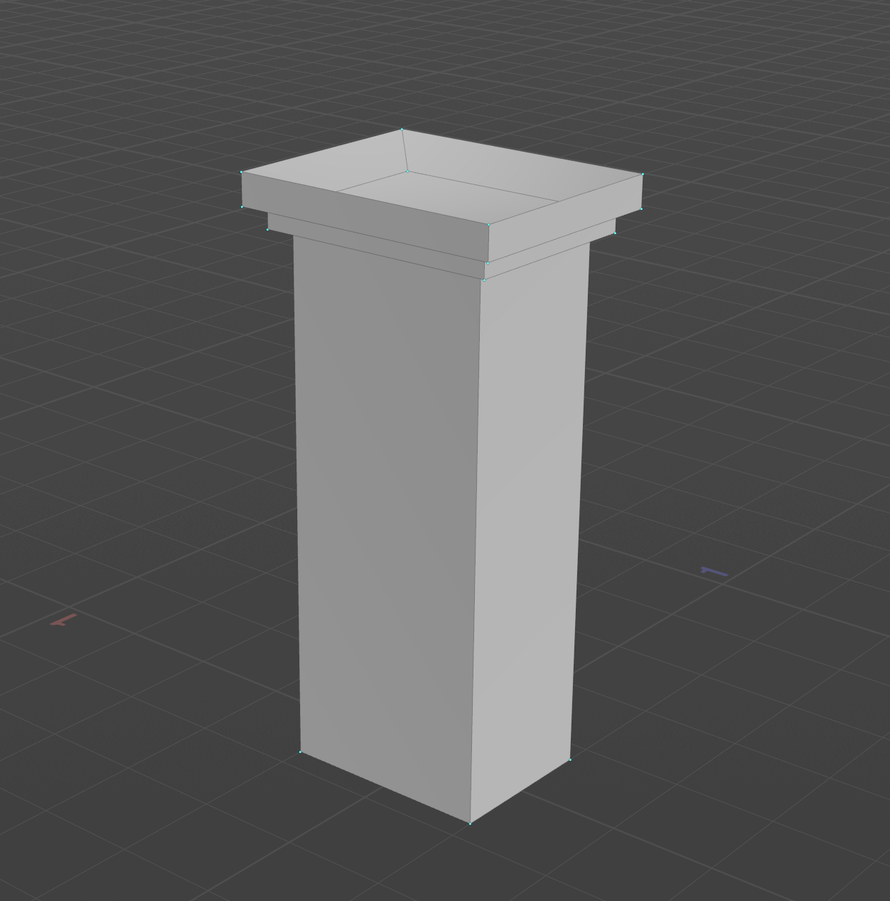
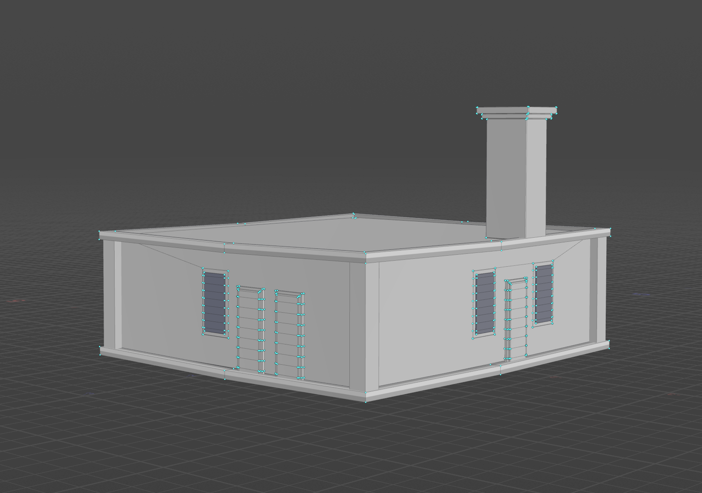
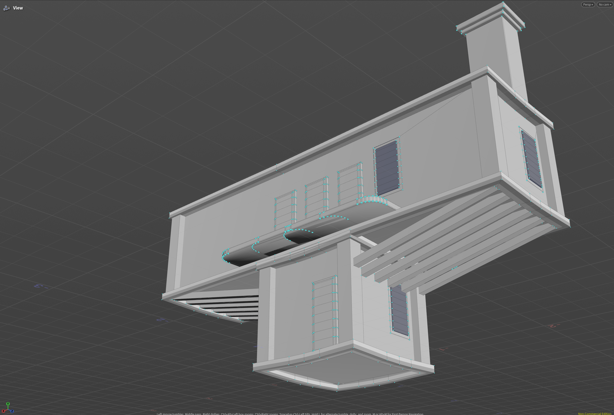
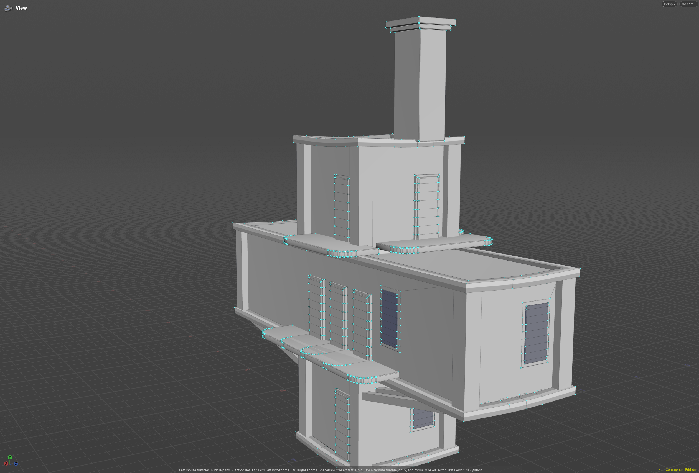

**University of Pennsylvania, CIS 5660: Procedural Graphics,
Homework 4**

- Bryce Joseph
- [Website](https://brycejo.com/), [LinkedIn](https://www.linkedin.com/in/brycejoseph/), [GitHub](https://github.com/brycej217)
- Tested on: Windows 11, Intel(R) CORE(TM) Ultra 9 275HX @ 2.70GHz 32.0GB, NVIDIA GeFORCE RTX 5080 Laptop GPU 16384MB

# CIS 5660 Homework 4: _Houdini Buildings_

# Overview

This project invovled creating a custom procedural building creator tool using Houdini. The tool allows users to specify the number and dimensions of the floors of their building, and these segments will automatically be popoulated with assets and additional procedural geometry. Much of the implementation followed this excellent tutorial by [Simon Houdini](https://youtu.be/uIe97023sDk?si=znT3d5FOex_nmTrb).

# Features
Much like the tutorial video, the inspirational architecture for my tool was the buildings found in Overwatch's Rio map. I tried to mimic this architectural style's boxy and cramped aesthetics.

## Assets
Several assets were modeled within Houdini itself including windows, doors, balconies and chimneys.

<table width="100%">
  <tr>
    <td width="50%">
      
    </td>
    <td width="50%">
      
    </td>
  </tr>
  <tr>
    <td width="50%">
      
    </td>
    <td width="50%">
      
    </td>
  </tr>
</table>

## Extremeties
Pillars, borders, and supports which automaticaly update based on the topology of the floor segments were also added to the system.

## Chimneys
A chimney model was added to the tool which is automatically placed and updated to be located on the top most floor of the structure.

